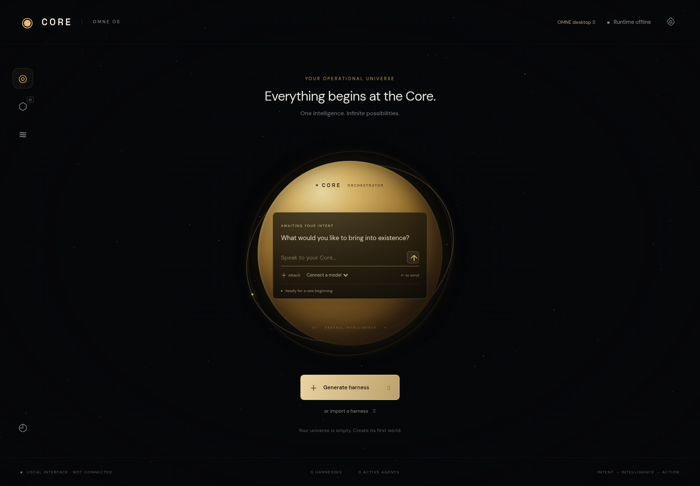

# Core command center

The galaxy hub is integrated into OMNE OS, based on `omne-first-boot`. That branch contains the
existing desktop, first-boot setup, model adapters, secrets, compute admission, agents, workers,
permission gateway and persistent OS services. The repository's `main` was only an initial README;
this integration does not merge or replace the existing stack of development branches.



## Start

Follow the repository setup, then run `OMNE serve`. Open `http://localhost:8787/hub/` for the
command center, or serve `shell/` on port 4173 and open `/hub/`. The desktop has a link to the hub;
the hub links back to the existing desktop. The universe starts empty, with a gold Core and no demo
harnesses.

In hub settings, enter the OMNE runtime URL and the token in `<OMNE_DATA_DIR>/hub-token` (normally
`memory/hub-token`). The token is generated with owner-only file permissions on Unix. You can
instead set `OMNE_HUB_TOKEN` to a secret of at least 24 characters. Do not commit that token. It is
stored only in the browser tab's session storage.

Models and API keys use OMNE's existing configuration, model manifests, connection UI and secret
service. There is no new model configuration file and no second listening process. Select a real
available model or **OMNE · adaptive routing**. Mock models are visible but unavailable for
generation so test output cannot be mistaken for live model work. Local models must be loaded and
healthy in OMNE's model runtime. Provider configuration may require restarting OMNE, as it did
before.

Describe an operation with **Generate harness**. Core can ask questions, create an agent graph,
revise one, or pause/resume a harness. Worlds use the actual agent/task graph and support six
environments: archipelago, observatory, garden, citadel, workshop and nebula. Agents produce durable
text or code artifacts. Import accepts the earlier Core prototype's blueprint JSON and starts it
paused. Database files from that prototype are not imported automatically.

## Shared services and optimizations

| Concern                   | Integration                                                                                                        |
| ------------------------- | ------------------------------------------------------------------------------------------------------------------ |
| Credentials               | Native OMNE providers and secret service; no keys in Pages assets                                                  |
| Local inference           | Native `ModelRuntime.generate`, preserving residency and admission checks                                          |
| Cloud inference           | Existing provider instance with a shared `ResourceManager` reservation, released on success or failure             |
| Automatic model selection | OMNE's capability/resource-aware router, excluding mock models and respecting local/offline mode                   |
| Parallelism               | Bounded harness pool; inference serialized per selected model to avoid colliding with single-request local engines |
| Fairness                  | Round-robin starting harness so one busy graph cannot always take the first slot                                   |
| State                     | SQLite using OMNE's WAL, synchronous-normal and busy-timeout configuration                                         |
| Writes                    | Unchanged records do not rewrite SQLite pages                                                                      |
| Artifacts                 | Indexed lookup by harness ID instead of deserializing every harness's output                                       |
| Events                    | Compact updates are published into OMNE's existing event bus                                                       |
| Polling                   | Incremental event cursor, no overlapping fetches, paused when the tab is hidden                                    |
| Telemetry                 | Native compute/model views cached for 10 seconds; no invented readings                                             |
| Rendering                 | Canvas capped at 20 FPS, reduced-motion support, no hidden-tab drawing                                             |
| Context                   | Each agent gets its assigned instructions and bounded dependency outputs                                           |

The hub API is mounted at `/hub/api/` inside the existing server and requires a bearer token.
Browser origins must be explicitly allowed; a same-origin loopback hub is accepted automatically.
These guards apply to the new hub routes. They do not retrofit authentication onto legacy desktop
endpoints: keep the complete OMNE server local or behind authenticated ingress when accessing it
remotely.

Token accounting is a **soft guard**, not a hard cost limit. Native providers do not share a maximum
output-token option. The hub reserves UTF-8 input bytes plus 8192 tokens, settles against provider
usage when reported, and retains reservations for missing/failed usage. Actual charges can exceed an
estimate; limits do not synchronize with provider accounts. Eco mode limits the harness pool to one
agent and increases scheduler idle waits. It does not set GPU clocks or guarantee watt savings.

## GitHub Pages

Enable **Settings → Pages → Source: GitHub Actions**, then rerun the **Publish command center**
workflow. If Pages is not yet enabled, the workflow saves the deployable artifact and skips
publication.

The Pages workflow packages an explicit allowlist of shell assets. The hub is the site root and the
existing desktop is at `desktop/`. It publishes from the integration branch as well as `main` and
`omne-first-boot`; the latest successful deployment is the hosted version.

GitHub Pages hosts the interface only. OMNE must remain running on a machine for model calls and
recurring work. Configure `OMNE_CORS_ORIGINS` to include `https://answerfirstai-ai.github.io` when
connecting from Pages. Preserve any local desktop origins you still need. A remote runtime needs
HTTPS and authenticated ingress; browsers may restrict HTTPS Pages connections to HTTP loopback.

Build the static package locally:

```sh
npm ci
npm run build
node scripts/development/build-pages.mjs
```

Only `dist/pages` is uploaded. The build never copies `memory/`, credentials, models, workspace
files, or Python runtime state.

## Current boundaries

Harness tasks currently create text and source-code artifacts. They do not automatically invoke
OMNE's external tools or grant themselves native permissions. Existing desktop tasks continue using
OMNE's permissioned tool gateway. Connecting harness nodes to those operations, nested harness
management, per-provider rate limits, and measured power optimization remain future work.

Instructions submitted while a Core plan is running queue in the browser. That queue is lost if the
tab closes. Saved graphs, tasks, artifacts, recurring schedules and token reservations persist on
the OMNE machine. Restarted in-flight tasks are retried, so model requests have at-least-once
semantics. Pausing stops new work; existing calls finish. A late output from an older graph revision
is retained as an artifact but cannot overwrite the new graph.

The existing OMNE test suites cover native behavior. `test_harness_engine.py` verifies graph
validation, restart recovery, recurring execution, token reservations and revision isolation.
`test_harness_integration.py` verifies native model reuse, compute reservation cleanup, shared
events, and hub authentication/origin handling without making paid model requests.
